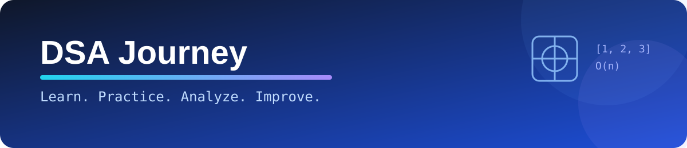
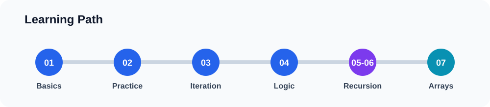
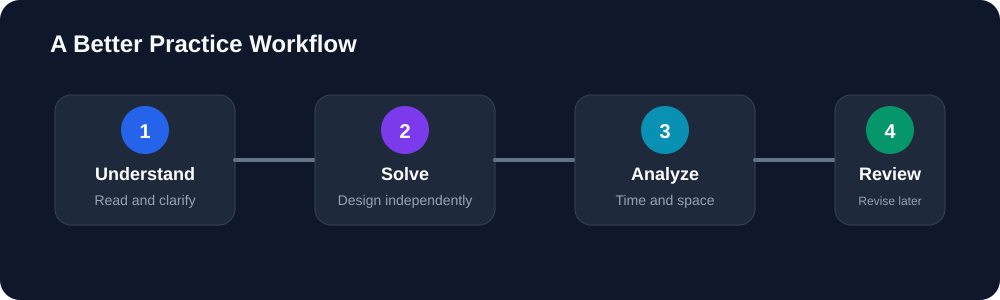

<div align="center">



# Data Structures & Algorithms Journey

[](https://www.python.org/)
[](.)
[](.)
[](.)

A structured, hands-on Python repository for mastering Data Structures and Algorithms through consistent daily practice.

</div>

## Table of Contents

- [Overview](#overview)
- [Learning Path](#learning-path)
- [Practice Workflow](#practice-workflow)
- [Repository Structure](#repository-structure)
- [Getting Started](#getting-started)
- [Practice Standards](#practice-standards)
- [Progress](#progress)
- [Contributing](#contributing)

## Overview

This repository documents a practical DSA learning journey using Python. Each day introduces, reinforces, or applies a computer science concept through focused examples and problem-solving exercises.

**Core topics covered**

| Area | Examples |
|:--|:--|
| Python Fundamentals | Variables, control flow, functions, modules |
| Arrays & Lists | Traversal, reversal, searching, aggregation |
| Recursion | Base cases, call stacks, recursive problem solving |
| Algorithm Analysis | Time complexity, space complexity, optimization |
| Problem Solving | Pattern recognition and iterative improvement |

## Learning Path

<div align="center">
  
</div>

The learning sequence progresses from foundational Python concepts to more structured algorithmic problems. Files are organized by day so concepts can be revisited and practiced in sequence.

## Practice Workflow

<div align="center">
  
</div>

1. **Understand** the problem, input, output, constraints, and edge cases.
2. **Solve independently** before comparing approaches.
3. **Analyze** the solution for correctness and complexity.
4. **Review** and re-solve later to strengthen retention.

## Repository Structure

```text
DSA-Journey/
└── Rohit/
    ├── assets/
    │   ├── dsa-banner.svg
    │   ├── learning-path.svg
    │   └── practice-workflow.svg
    ├── Day-01/
    ├── Day-02/
    ├── Day-03/
    ├── Day-04/
    ├── Day-05/
    ├── Day-06-Recursion/
    ├── Day-07-Array/
    ├── main.py
    ├── pyproject.toml
    ├── requirements.txt
    ├── uv.lock
    └── README.md
```

### Key Topics by Directory

| Directory | Focus |
|:--|:--|
| `Day-01` | Python modules and helper utilities |
| `Day-02` | Early Python practice |
| `Day-03` | Applied programming exercises |
| `Day-04` | Problem-solving practice |
| `Day-05` | Digit, search, and recursion exercises |
| `Day-06-Recursion` | Arrays, lists, flattening, subsets, and Tower of Hanoi |
| `Day-07-Array` | Array manipulation |

## Getting Started

### Prerequisites

- Python 3.13 or later
- `uv` recommended for environment and package management
- Git for cloning and version control

### Installation

Clone the repository and enter the Python project:

```bash
git clone https://github.com/rohitlonkar2006/DSA-Journey.git
cd DSA-Journey/Rohit
```

Create a virtual environment and install dependencies:

```bash
python -m venv .venv
```

Activate it on Windows:

```powershell
.venv\Scripts\Activate.ps1
```

Install the project dependencies:

```bash
pip install -r requirements.txt
```

### Run a Program

```bash
python main.py
```

Run an exercise by providing its relative path:

```bash
python Day-07-Array/reverse-array.py
```

> On macOS or Linux, activate the environment with `source .venv/bin/activate`.

## Practice Standards

- Write clear, readable Python code.
- Prefer descriptive variable and function names.
- Separate input, processing, and output where practical.
- Test normal cases, empty inputs, and boundary conditions.
- Analyze both time and auxiliary space complexity.
- Revisit older problems periodically.

### Complexity Reference

| Complexity | Typical Meaning |
|:--|:--|
| `O(1)` | Constant-time operation |
| `O(log n)` | Logarithmic search or division |
| `O(n)` | Linear traversal |
| `O(n log n)` | Efficient divide-and-conquer sorting |
| `O(n²)` | Common nested-loop algorithm |

## Progress

| Stage | Status |
|:--|:--|
| Python fundamentals | In progress |
| Array and list problems | In progress |
| Recursion | Introduced |
| Searching and sorting | Upcoming |
| Linked lists | Upcoming |
| Trees and graphs | Upcoming |
| Dynamic programming | Upcoming |

## Contributing

Contributions that improve explanations, add tested examples, or enhance readability are welcome.

1. Fork the repository.
2. Create a focused feature branch.
3. Keep exercises consistent with the existing daily structure.
4. Test the Python file before submitting a pull request.
5. Open a pull request with a clear description of the change.

---

<div align="center">

**Keep solving. Keep reviewing. Keep improving.**

This project is intended for educational and personal learning purposes.

</div>
